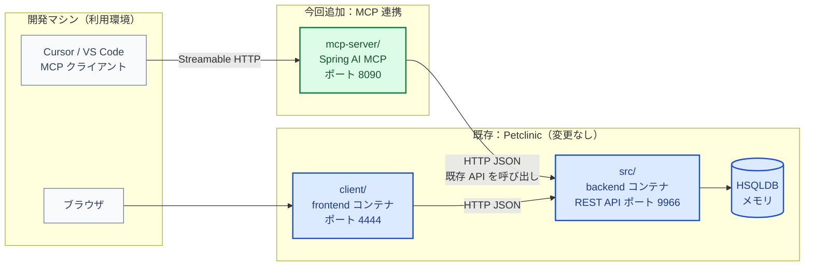
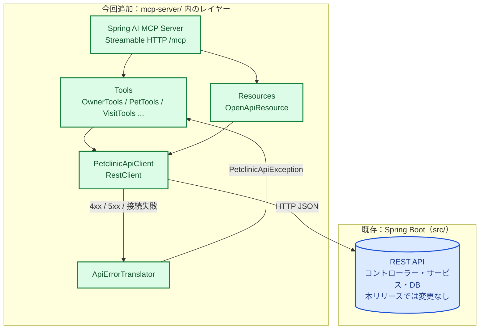

# Spring Petclinic（React 版）MCP 連携機能設計書

この文書は、[MCP 連携導入計画書](MCP導入/0.概要.md) で決定した方針に基づき、Petclinic に MCP（Model Context Protocol）サーバーを追加するための設計をまとめたものです。既存 API の仕様は 2026-11-19 時点のコードと、開発用コンテナで起動した API への実際のリクエスト結果に基づきます。

## 1. 概要

AI クライアント（Cursor / VS Code など）から、自然言語の指示で Petclinic のデータを照会・登録できるようにします。MCP サーバーは既存の Spring Boot アプリとは別のサービスとして動き、既存の REST API を HTTP で呼び出すラッパーとして振る舞います。

### 1.1 計画書で決定した方針

| 項目 | 決定内容 |
| --- | --- |
| アーキテクチャ | 独立した MCP サーバー（`mcp-server/`）を新設し、既存 REST API を呼び出す（方式 A） |
| 実装言語・ランタイム | Java（Spring AI MCP、既存バックエンドと同系技術） |
| トランスポート | HTTP（Streamable HTTP）。コンテナ間・外部 HTTP 接続も対象とする |
| 提供機能 | Tools 9 種（読み取り系 6、登録系 3）、Resources 1 種（OpenAPI 仕様） |
| 実行環境 | `docker-compose.dev.yml` に `mcp-server` サービスを追加し、Dev Container の起動フローと共存させる |
| 動作確認 | AI クライアントからのデータ照会結果が、React 画面（`http://localhost:4444`）および API と一致すること |

### 1.2 対象外

- 既存バックエンド（`src/`）とフロントエンド（`client/`）のコード変更。
- 削除系・更新系のツール（`delete_*`、`update_*`）。誤操作を防ぐため、初期リリースでは提供しません。
- 獣医、診療科、ペット種別、ユーザーの登録。

## 2. 全体構成



**凡例:** 緑の枠＝今回追加（`mcp-server/`・Compose の `mcp-server` サービス）。青の枠＝既存（`src/`・`client/`・`backend` / `frontend` コンテナ）。MCP は DB に直接つながらず、既存 REST API だけを利用します。

> **図の見方（Cursor / VS Code）:** 既定の Markdown プレビューだけでは Mermaid が描画されないことがあります。リポジトリの `.vscode/settings.json` で `markdown.mermaid.enabled` を有効にするか、拡張機能 **Markdown Preview Mermaid Support**（`bierner.markdown-mermaid`）を入れてから、プレビューを開き直してください（Dev Container 利用時は `devcontainer.json` に同拡張を入れています）。

- MCP サーバーはデータベースへ直接アクセスせず、必ず REST API を経由します。そのため、API のバリデーション、トランザクション、認証設定がそのまま適用されます。
- React 画面と MCP サーバーは同じ API を使うため、MCP 経由で登録したデータは画面にもそのまま反映されます。既定の HSQLDB はメモリ上にあるため、`backend` コンテナを再起動するとデータは初期状態に戻ります。

### 2.1 技術スタック

| 項目 | 内容 |
| --- | --- |
| 言語 | Java 17（既存バックエンドと同じ） |
| フレームワーク | Spring Boot 3.5 系、Spring AI 1.1 系（実装着手時点の最新 GA に合わせる） |
| MCP ライブラリ | `spring-ai-starter-mcp-server-webmvc`（Spring MVC 上で Streamable HTTP を提供） |
| API 呼び出し | Spring `RestClient` |
| ビルド | Maven（`mcp-server/` 配下に独立した `pom.xml` と Maven Wrapper） |
| テスト | JUnit 5、`MockRestServiceServer`（API 応答のモック）、MCP Inspector（手動確認） |

既存バックエンドは Spring Boot 3.2.1 ですが、MCP サーバーは独立したプロジェクトのため、Spring AI が必要とするバージョンを個別に採用できます。既存の `pom.xml` は変更しません。

## 3. ディレクトリ構成

```text
mcp-server/
├── pom.xml
├── mvnw, mvnw.cmd, .mvn/
├── Dockerfile                # 本番用（JAR をビルドして JRE で起動）
├── Dockerfile.dev            # 開発用（ソースをマウントして spring-boot:run）
├── README.md                 # 起動方法と動作確認手順の短いメモ
└── src/
    ├── main/
    │   ├── java/org/springframework/samples/petclinic/mcp/
    │   │   ├── PetclinicMcpServerApplication.java
    │   │   ├── config/
    │   │   │   ├── PetclinicApiProperties.java     # 接続先・タイムアウト・認証情報
    │   │   │   ├── RestClientConfig.java
    │   │   │   └── OriginValidationFilter.java     # Origin ヘッダーの検証
    │   │   ├── client/
    │   │   │   ├── PetclinicApiClient.java         # REST API 呼び出し
    │   │   │   ├── PetclinicApiException.java      # AI 向けメッセージを持つ例外
    │   │   │   ├── ApiErrorTranslator.java         # HTTP エラー → 例外の変換
    │   │   │   └── dto/                            # Owner, Pet, PetType, Visit, Vet などの record
    │   │   ├── tools/
    │   │   │   ├── OwnerTools.java
    │   │   │   ├── PetTools.java
    │   │   │   ├── VetTools.java
    │   │   │   ├── PetTypeTools.java
    │   │   │   └── VisitTools.java
    │   │   └── resources/
    │   │       └── OpenApiResource.java
    │   └── resources/
    │       └── application.yml
    └── test/java/org/springframework/samples/petclinic/mcp/
        ├── client/PetclinicApiClientTests.java
        ├── client/ApiErrorTranslatorTests.java
        └── tools/*ToolsTests.java
```

## 4. レイヤー構成



**凡例:** 上段の緑枠はすべて新規モジュール `mcp-server/` の責務。下段の青枠は既存バックエンドのみ。業務ロジック・DB アクセスは既存 API 側に留まります。

- **Tools / Resources**: MCP に公開する入口です。入力の簡単な検証（必須項目、日付形式）と、AI が読みやすい形への整形を担当します。業務ルールは持ちません。
- **PetclinicApiClient**: REST API の呼び出しだけを担当します。1 つの API 呼び出しに 1 つのメソッドを対応させます。
- **ApiErrorTranslator**: API のエラー応答や接続失敗を、原因と対処が分かるメッセージに変換します（6 章）。

ツールの登録には、Spring AI 1.1 のアノテーション（`@McpTool`、`@McpToolParam`、`@McpResource`）を使います。説明文（`description`）は AI がツールを選ぶ手がかりになるため、用途と入力の制約を具体的に書きます。

## 5. 提供する機能

### 5.1 参照する既存 API

ベース URL は `http://backend:9966/petclinic/api`（コンテナ間）です。開発マシンからは `http://localhost:9966/petclinic/api` で同じ API に届きます。

| メソッド | パス | 用途 | 確認した応答 |
| --- | --- | --- | --- |
| GET | `/owners?lastName={lastName}` | 飼い主検索（前方一致、省略時は全件） | 200、ペットを含む配列 |
| GET | `/owners/{ownerId}` | 飼い主取得 | 200、存在しない ID は 404（本文なし） |
| POST | `/owners` | 飼い主登録 | 201、入力不正は 400（`errors` ヘッダー） |
| GET | `/pets` | ペット一覧 | 200 |
| GET | `/owners/{ownerId}/pets/{petId}` | 飼い主のペット取得 | 200、存在しない場合は 404 |
| POST | `/owners/{ownerId}/pets` | ペット登録 | 201 |
| GET | `/vets` | 獣医一覧（診療科を含む） | 200 |
| GET | `/pettypes` | ペット種別一覧 | 200 |
| GET | `/visits` | 来院記録一覧 | 200 |
| POST | `/owners/{ownerId}/pets/{petId}/visits` | 来院記録登録 | 201、存在しないペットは 400（DB 制約違反） |
| GET | `/petclinic/v3/api-docs.yaml` | OpenAPI 仕様（YAML） | 200（springdoc が生成） |

### 5.2 Tools

読み取り系は `readOnlyHint: true` を付けます。登録系は `readOnlyHint: false`、`destructiveHint: false` とし、データを追加するだけで既存データは変更しないことを AI クライアントに伝えます。

| ツール名 | 種別 | 入力 | 呼び出す API | 出力 |
| --- | --- | --- | --- | --- |
| `list_owners` | 参照 | `lastName`（任意） | `GET /owners` | 飼い主の配列（ID、氏名、住所、都市、電話、ペット名と種別） |
| `get_owner` | 参照 | `ownerId`（必須） | `GET /owners/{ownerId}` | 飼い主 1 件（ペットと来院記録を含む） |
| `create_owner` | 登録 | `firstName`、`lastName`、`address`、`city`、`telephone`（すべて必須） | `POST /owners` | 登録した飼い主（採番された ID を含む） |
| `list_pets` | 参照 | `ownerId`（任意） | `GET /pets` | ペットの配列。`ownerId` を指定すると、MCP サーバー側で絞り込む |
| `create_pet` | 登録 | `ownerId`、`name`、`birthDate`、`petTypeId`（すべて必須） | `GET /pettypes`、`POST /owners/{ownerId}/pets` | 登録したペット |
| `list_vets` | 参照 | なし | `GET /vets` | 獣医の配列（診療科を含む） |
| `list_pet_types` | 参照 | なし | `GET /pettypes` | ペット種別の配列 |
| `list_visits` | 参照 | `petId`（任意） | `GET /visits` | 来院記録の配列。`petId` を指定すると、MCP サーバー側で絞り込む |
| `create_visit` | 登録 | `ownerId`、`petId`、`description`（必須）、`date`（任意、省略時は当日） | `GET /owners/{ownerId}/pets/{petId}`、`POST /owners/{ownerId}/pets/{petId}/visits` | 登録した来院記録 |

各ツールの補足は次のとおりです。

- **`create_owner`**: 入力の制約は API（`OwnerFields`）に合わせます。`firstName`、`lastName` は英字のみで 1〜30 文字、`address` は 1〜255 文字、`city` は 1〜80 文字、`telephone` は数字のみで 1〜20 文字です。MCP サーバー側では重複して検証せず、API のバリデーション結果を整形して返します。制約はツールの説明文に書き、AI が最初から正しい値を作れるようにします。
- **`create_pet`**: API はペット種別を `{"id": 1, "name": "cat"}` の形で受け取ります。AI には `petTypeId` だけを入力させ、MCP サーバーが `GET /pettypes` で名前を補います。存在しない ID の場合は、使える種別の一覧をエラーメッセージに含めます。`birthDate` は `yyyy-MM-dd` 形式です。
- **`create_visit`**: 存在しないペットを指定すると、API はデータベースの制約違反（SQL を含む 400 応答）を返します。これを避けるため、登録の前に `GET /owners/{ownerId}/pets/{petId}` でペットと飼い主の組み合わせを確認し、見つからなければ「見つかりません」というメッセージを返します。`description` は 1〜255 文字です。
- **一覧の絞り込み**: API に `ownerId` や `petId` での検索がないため、全件を取得してから MCP サーバー側で絞り込みます。サンプルデータの規模（飼い主 10 件程度）では問題ありません。

### 5.3 Resources

| URI | 名前 | MIME タイプ | 内容 |
| --- | --- | --- | --- |
| `petclinic://openapi.yml` | Petclinic API 仕様 | `application/yaml` | バックエンドの OpenAPI 仕様 |

読み込まれるたびに `GET /petclinic/v3/api-docs.yaml` から取得します。リポジトリの `src/main/resources/openapi.yml` をコピーしないため、仕様の二重管理になりません。バックエンドが停止している場合は、6 章の接続失敗メッセージを返します。

## 6. エラーハンドリング

API の応答を `ApiErrorTranslator` で `PetclinicApiException` に変換し、ツールのエラー結果（`isError: true`）として AI クライアントに返します。メッセージには「何が起きたか」と「次に何をすればよいか」を含めます。

| 状況 | API の応答（確認結果） | AI に返すメッセージの例 |
| --- | --- | --- |
| 接続失敗 | 接続拒否・名前解決失敗 | `Petclinic API（http://backend:9966/petclinic/api）に接続できません。backend コンテナが起動しているか確認してください。` |
| タイムアウト | 応答なし | `Petclinic API が 10 秒以内に応答しませんでした。時間をおいて再試行してください。` |
| データなし | 404、本文なし | `飼い主 ID 999 は見つかりません。list_owners で ID を確認してください。` |
| 入力不正 | 400、`errors` ヘッダーに JSON 配列（`fieldName`、`fieldValue`、`errorMessage`） | `入力内容に誤りがあります。telephone: must match "^[0-9]*$"（入力値: abc）` のように、項目ごとに 1 行で列挙 |
| その他の 400 | 400、本文に `className` と `exMessage`（SQL を含むことがある） | `Petclinic API が要求を処理できませんでした（DataIntegrityViolationException）。関連するデータが存在するか確認してください。` |
| 認証エラー | 401 / 403 | `Petclinic API の認証に失敗しました。PETCLINIC_API_USERNAME / PETCLINIC_API_PASSWORD を確認してください。` |
| サーバーエラー | 5xx | `Petclinic API でエラーが発生しました（HTTP 500）。backend コンテナのログを確認してください。` |

- 入力不正の詳細は応答本文ではなく `errors` ヘッダーに入っているため、ヘッダーを必ず読みます。
- 「その他の 400」では、`exMessage` に SQL 文やテーブル名が含まれることがあります。AI にはクラス名だけを返し、詳細は MCP サーバーのログ（DEBUG レベル）にだけ出力します。
- 想定外の例外も、スタックトレースを返さず「内部エラー」として返します。

## 7. 設定

`application.yml` に既定値を書き、環境変数で上書きします。

| 環境変数 | 既定値 | 内容 |
| --- | --- | --- |
| `PETCLINIC_API_BASE_URL` | `http://localhost:9966/petclinic/api` | 呼び出す API のベース URL。Compose 内では `http://backend:9966/petclinic/api` |
| `PETCLINIC_API_TIMEOUT` | `10s` | API 呼び出しのタイムアウト |
| `PETCLINIC_API_USERNAME` | （空） | バックエンドの Basic 認証ユーザー。空なら認証ヘッダーを送らない |
| `PETCLINIC_API_PASSWORD` | （空） | 同パスワード |
| `MCP_SERVER_PORT` | `8090` | MCP サーバーの待ち受けポート |
| `MCP_ALLOWED_ORIGINS` | `http://localhost,http://127.0.0.1` | 受け付ける `Origin` ヘッダー（9 章） |

Spring AI の主な設定は次のとおりです。

```yaml
server:
  port: ${MCP_SERVER_PORT:8090}

spring:
  ai:
    mcp:
      server:
        name: petclinic-mcp-server
        version: 0.1.0
        type: SYNC
        protocol: STREAMABLE
        streamable-http:
          mcp-endpoint: /mcp
        capabilities:
          tool: true
          resource: true

petclinic:
  api:
    base-url: ${PETCLINIC_API_BASE_URL:http://localhost:9966/petclinic/api}
    timeout: ${PETCLINIC_API_TIMEOUT:10s}
    username: ${PETCLINIC_API_USERNAME:}
    password: ${PETCLINIC_API_PASSWORD:}
```

既存バックエンドは `petclinic.security.enable=false` で認証が無効のため、通常は認証情報を設定する必要はありません。認証を有効にする場合も、認証情報はリポジトリにコミットせず、環境変数で渡します。

## 8. Docker / Dev Container 連携

### 8.1 `docker-compose.dev.yml` への追加

```yaml
services:
  # backend / frontend は変更しない
  mcp-server:
    build:
      context: ./mcp-server
      dockerfile: Dockerfile.dev
    image: petclinic-mcp-server:dev
    ports:
      - "127.0.0.1:8090:8090"
    environment:
      PETCLINIC_API_BASE_URL: http://backend:9966/petclinic/api
    volumes:
      - ./mcp-server/src:/workspace/src
      - ./mcp-server/pom.xml:/workspace/pom.xml
      - mcp-server-target:/workspace/target
    depends_on:
      - backend

volumes:
  backend-target:
  mcp-server-target:
```

- ポートは開発マシンのループバック（`127.0.0.1`）にだけ公開し、同じネットワーク上の他のマシンからは接続できないようにします。
- `depends_on` は起動順を決めるだけで、API の準備完了までは待ちません。MCP サーバーは起動時に API へ接続せず、ツールが呼ばれた時点で接続します。API がまだ起動中なら、6 章の接続失敗メッセージを返します。
- 開発用イメージは、既存の `backend` と同じくソースをマウントし、`spring-boot:run` で起動します。ソースを変更したら、コンテナの再起動で反映します。
- 本番用の `docker-compose.yml` への追加は、開発用で動作を確認してから判断します。

### 8.2 `.devcontainer/devcontainer.json`

`runServices` に `mcp-server` を追加します。Dev Container の接続先（`service: backend`）、`overrideCommand: false`、拡張機能の設定は変更しません。

```jsonc
"runServices": [
  "backend",
  "frontend",
  "mcp-server"
],
```

### 8.3 AI クライアントの設定

Cursor の場合は `.cursor/mcp.json` に次を追加します。VS Code の場合も、MCP 設定に同じ URL を登録します。

```json
{
  "mcpServers": {
    "petclinic": {
      "url": "http://localhost:8090/mcp"
    }
  }
}
```

接続先 URL は、AI クライアントがどこで動くかによって変わります。

| AI クライアントの実行場所 | 接続先 URL |
| --- | --- |
| 開発マシン（ホスト） | `http://localhost:8090/mcp` |
| Dev Container（`backend` コンテナ）の中 | `http://mcp-server:8090/mcp` |

Dev Container に接続したエディタで MCP がどちら側で動くかは、実装時に確認します（10 章）。

## 9. セキュリティ

- **公開範囲**: MCP サーバー自体には認証を付けず、ポートをループバックにだけ公開することで保護します。外部ネットワークへ公開する場合は、トークン認証などを別途設計します。
- **Origin の検証**: MCP 仕様に従い、`Origin` ヘッダーが `MCP_ALLOWED_ORIGINS` にない要求は 403 で拒否します。ブラウザ上の悪意あるページから、DNS リバインディングでローカルの MCP サーバーを操作されることを防ぎます。`Origin` ヘッダーのない要求（エディタなどのネイティブクライアント）は受け付けます。
- **操作の範囲**: 削除・更新のツールは提供しません。登録系ツールは、AI クライアント側で実行前に確認を求める設定を推奨します。
- **情報の扱い**: エラーメッセージに SQL やスタックトレースを含めません（6 章）。リクエスト本文はログに出しません。
- **公開前チェック**: 認証情報、API キー、ローカル環境固有のパスやホスト名が、コード、設定ファイル、コミット履歴に含まれていないことを確認します。追加するファイルは既存と同じ Apache License 2.0 の下で公開します。

## 10. テストと動作確認

### 10.1 自動テスト

| 対象 | 方法 | 主な確認内容 |
| --- | --- | --- |
| `PetclinicApiClient` | `MockRestServiceServer` で API 応答を再現 | パスとクエリの組み立て、JSON の読み込み |
| `ApiErrorTranslator` | 単体テスト | 6 章の各状況（404、`errors` ヘッダー付き 400、SQL を含む 400、接続失敗、タイムアウト）のメッセージ |
| 各 Tools | クライアントをモック | 絞り込み、`create_pet` の種別補完、`create_visit` の事前確認 |

### 10.2 手動での動作確認

1. `docker compose -f docker-compose.dev.yml up --build` で `backend`、`frontend`、`mcp-server` を起動します。
2. MCP Inspector（`npx @modelcontextprotocol/inspector`）で `http://localhost:8090/mcp` に接続し、9 個のツールと 1 個のリソースが表示されることを確認します。
3. AI クライアントから次のような指示を出し、結果が React 画面（`http://localhost:4444`）と API の応答に一致することを確認します。

| 指示の例 | 使われるツール | 照合先 |
| --- | --- | --- |
| 「Davis さんの飼い主情報を教えて」 | `list_owners` | 画面の Find Owners で `Davis` を検索した結果（Betty Davis、Harold Davis） |
| 「飼い主 ID 1 のペットは？」 | `get_owner` | 画面の George Franklin の詳細（Leo、cat） |
| 「獣医の一覧と専門分野を見せて」 | `list_vets` | 画面の Veterinarians 一覧 |
| 「登録できるペットの種類は？」 | `list_pet_types` | 画面の Pet Types 一覧 |
| 「ペット ID 8 の来院記録は？」 | `list_visits` | `GET /api/visits` のうち `petId` が 8 のもの |
| 「飼い主 ID 999 を表示して」 | `get_owner` | 「見つかりません」というメッセージが返ること |
| `backend` を停止してから照会する | 任意 | 接続失敗のメッセージが返ること |

登録系ツール（`create_owner`、`create_pet`、`create_visit`）は自動テストで確認し、手動確認は任意とします。確認する場合は、登録後に画面を再読み込みして反映されることを見ます。

### 10.3 Cursor からの手動テスト手順

運用手順の詳細は [mcp-server/README.md](../../mcp-server/README.md) と [環境構築手順.md](../環境構築手順.md) の「3.2 Cursor から MCP を接続して手動テストする」に記載しています。要点は次のとおりです。

1. Dev Container（または `docker compose -f docker-compose.dev.yml up --build`）で `backend` / `frontend` / `mcp-server` を起動する。
2. ホスト上の Cursor が読む `.cursor/mcp.json` で `http://localhost:8090/mcp` に接続する（MCP クライアントはホスト側で動作する想定）。
3. **Cursor Settings → MCP** で `petclinic` が接続済みか確認し、ツール 9 件・リソース 1 件が見えることを確認する。
4. 10.2 の表に従いチャットまたは MCP パネルでツールを実行し、http://localhost:4444 および API と結果を突き合わせる。

トラブル時はホスト側で `docker compose -f docker-compose.dev.yml logs -f mcp-server` により MCP コンテナのログを確認する（手順は [mcp-server/README.md](../../mcp-server/README.md) の「ログの確認」）。

### 10.4 やり取りの可視化（テスト時）

手動テスト時に Cursor と `mcp-server` の間で何が起きているかは、次で追えます。

- **シーケンス図・JSON-RPC・ログの読み方**: [mcp-server/docs/CursorとMCPのやり取り.md](../../mcp-server/docs/CursorとMCPのやり取り.md)
- **サーバー側トレース**: 環境変数 `MCP_TRACE_ENABLED`（既定 `true`）で、`[mcp-trace]` 行が inbound（`/mcp` への HTTP）→ tool（ツール名・引数）→ outbound-api（既存 REST 呼び出し）の順に出力されます。JSON-RPC 本文はログに出しません（9 章）。

## 11. 実装時に確認する事項

- Spring AI の最新 GA バージョンと、それが対応する Spring Boot のバージョン。設定キー（`spring.ai.mcp.server.protocol` など）とアノテーション名が、本書の記載と一致するかを確認します。
- Dev Container に接続した Cursor / VS Code で、MCP クライアントがホスト側とコンテナ側のどちらで動くか。結果に応じて、8.3 節の接続先 URL を手順書に明記します。
- MCP Inspector を実行する Node.js の場所。`backend` コンテナには Node.js がないため、開発マシンか `frontend` コンテナで実行します。
