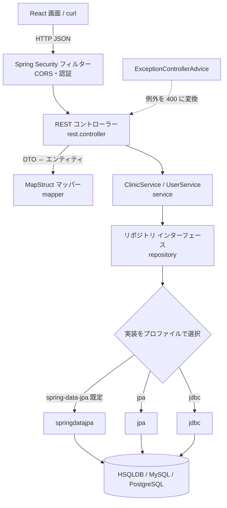
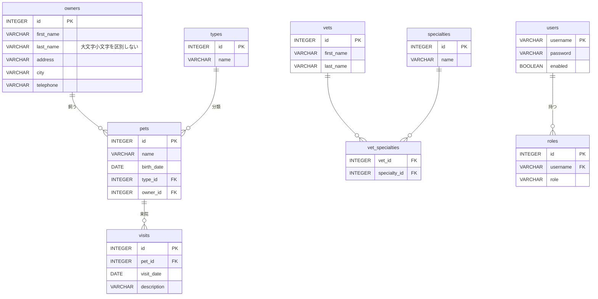

# Spring Petclinic（React 版）バックエンド設計書

この文書は、`src/main/java` 配下の Spring Boot アプリケーション（REST API）の現状の設計をまとめたものです。記載内容は 2026-11-18 時点のコードと、Docker で起動した API への実際のリクエスト結果に基づきます。

## 1. 概要

動物病院の飼い主、ペット、来院記録、獣医を管理する REST API です。画面は持たず、JSON を返します。画面は別コンテナの React アプリケーションが担当します（[フロントエンド設計書](設計書_フロントエンド.md)）。

| 項目 | 内容 |
| --- | --- |
| 言語 | Java 17 |
| フレームワーク | Spring Boot 3.2.1（Spring MVC、Spring Data JPA、Spring Security、Spring AOP） |
| API 定義 | OpenAPI 3.0.1（`src/main/resources/openapi.yml`） |
| コード生成 | openapi-generator-maven-plugin 6.3.0（API インターフェースと DTO を生成） |
| オブジェクト変換 | MapStruct 1.4.1 |
| API ドキュメント | springdoc-openapi 2.0.2（Swagger UI） |
| データベース | HSQLDB（既定、メモリ）、MySQL、PostgreSQL |
| ビルド | Maven（`mvnw`、Maven 3.6.3） |
| 成果物 | `spring-petclinic-rest-3.2.1.jar` |

## 2. 実行時の構成

| 項目 | 値 |
| --- | --- |
| ポート | `9966` |
| コンテキストパス | `/petclinic/` |
| API のベース URL | `http://localhost:9966/petclinic/api` |
| Swagger UI | `http://localhost:9966/petclinic/swagger-ui/index.html`（`/petclinic/` にアクセスするとリダイレクト） |
| OpenAPI（JSON） | `http://localhost:9966/petclinic/v3/api-docs` |
| 既定のプロファイル | `hsqldb,spring-data-jpa` |
| ログレベル | `org.springframework=DEBUG` |

Docker では `Dockerfile` のマルチステージビルドで JAR を作り、`eclipse-temurin:17-jre` 上で `java -jar app.jar` として起動します。

## 3. レイヤー構成



各層の役割は次のとおりです。

- **コントローラー**: OpenAPI から生成された `OwnersApi` などのインターフェースを実装します。URL とパラメーターの対応は生成コード側にあり、コントローラーは処理だけを書きます。メソッドごとに `@PreAuthorize` でロールを指定しています（認証を有効にしたときだけ効きます）。
- **マッパー**: MapStruct で、エンティティと生成 DTO（`OwnerDto`、`PetFieldsDto` など）を相互に変換します。
- **サービス**: `ClinicServiceImpl` が全コントローラーの窓口です。`@Transactional` でトランザクション境界を決めています。
- **リポジトリ**: インターフェースは共通で、実装は Spring のプロファイル（`spring-data-jpa`、`jpa`、`jdbc`）で 1 つだけが有効になります。

## 4. パッケージ構成

基点パッケージは `org.springframework.samples.petclinic` です。

| パッケージ | 内容 |
| --- | --- |
| `(ルート)` | `PetClinicApplication`（起動クラス） |
| `rest.controller` | REST コントローラー 8 個、`BindingErrorsResponse` |
| `rest.advice` | `ExceptionControllerAdvice`（例外処理） |
| `rest.api` / `rest.dto` | OpenAPI から生成（`target/generated-sources/openapi`）。ソース管理には含まれない |
| `mapper` | MapStruct のマッパー（Owner、Pet、PetType、Vet、Visit、Specialty、User） |
| `service` | `ClinicService`、`ClinicServiceImpl`、`UserService`、`UserServiceImpl` |
| `repository` | リポジトリ インターフェース |
| `repository.springdatajpa` / `jpa` / `jdbc` | プロファイル別の実装 |
| `model` | JPA エンティティ |
| `security` | 認証・CORS の設定、ロール定数 |
| `util` | `EntityUtils`、`CallMonitoringAspect`（呼び出し回数と時間を JMX で公開） |

## 5. API 一覧

ベース URL は `http://localhost:9966/petclinic/api` です。「ロール」は認証を有効にしたときに必要なロールです。

### 5.1 飼い主（owner）

| メソッド | パス | 処理 | 成功時 | ロール |
| --- | --- | --- | --- | --- |
| GET | `/owners?lastName={姓}` | 姓の前方一致で検索。省略時は全件 | 200（該当なしは 404） | OWNER_ADMIN |
| POST | `/owners` | 飼い主を登録 | 201 | OWNER_ADMIN |
| GET | `/owners/{ownerId}` | 飼い主を 1 件取得（ペットと来院記録を含む） | 200 | OWNER_ADMIN |
| PUT | `/owners/{ownerId}` | 飼い主を更新 | 204 | OWNER_ADMIN |
| DELETE | `/owners/{ownerId}` | 飼い主を削除 | 204 | OWNER_ADMIN |
| POST | `/owners/{ownerId}/pets` | 飼い主にペットを追加 | 201 | OWNER_ADMIN |
| GET | `/owners/{ownerId}/pets/{petId}` | 飼い主のペットを 1 件取得 | 200 | OWNER_ADMIN |
| PUT | `/owners/{ownerId}/pets/{petId}` | 飼い主のペットを更新 | 204 | OWNER_ADMIN |
| POST | `/owners/{ownerId}/pets/{petId}/visits` | ペットに来院記録を追加 | 201 | OWNER_ADMIN |

### 5.2 その他のリソース

| リソース | パス | 操作 | ロール |
| --- | --- | --- | --- |
| ペット | `/pets`、`/pets/{petId}` | 一覧・登録・取得・更新・削除 | OWNER_ADMIN |
| 来院記録 | `/visits`、`/visits/{visitId}` | 一覧・登録・取得・更新・削除 | OWNER_ADMIN |
| ペットの種類 | `/pettypes`、`/pettypes/{petTypeId}` | 一覧・取得は OWNER_ADMIN か VET_ADMIN、登録・更新・削除は VET_ADMIN | 左記 |
| 獣医 | `/vets`、`/vets/{vetId}` | 一覧・登録・取得・更新・削除 | VET_ADMIN |
| 専門分野 | `/specialties`、`/specialties/{specialtyId}` | 一覧・登録・取得・更新・削除 | VET_ADMIN |
| ユーザー | `/users` | 登録のみ | ADMIN |
| 失敗用 | `/oops` | 実行時例外を投げ、エラー応答の確認に使う | なし |

共通の応答コードの決まりは次のとおりです。

- 取得は 200、登録は 201、更新と削除は 204 です。更新は 204 ですが、本文に更新後の JSON も入っています。
- 一覧が 0 件のときは 404 を返します。
- `POST /pets` だけは保存せず、受け取った内容をそのまま 200 で返します。

### 5.3 主な入力項目と検証

検証ルールは `openapi.yml` に書かれ、生成された DTO に Bean Validation の注釈として入ります。

| DTO | 項目 | ルール |
| --- | --- | --- |
| OwnerFields | `firstName`、`lastName` | 必須、1〜30 文字、英字のみ（`^[a-zA-Z]*$`） |
| | `address` | 必須、1〜255 文字 |
| | `city` | 必須、1〜80 文字 |
| | `telephone` | 必須、1〜20 文字、数字のみ |
| PetFields | `name` | 必須、30 文字まで |
| | `birthDate` | 必須、日付（`YYYY-MM-DD`） |
| | `type` | 必須、`{ "id": 1, "name": "cat" }` の形のオブジェクト |
| VisitFields | `date` | 日付（任意） |
| | `description` | 必須、1〜255 文字 |

ペットの登録では、`type.name` で種類を引き直して保存します（`findPetTypeByName`）。`type.id` だけでは種類を特定しません。

## 6. データモデル



エンティティの関連は次のとおりです。

- `Owner` → `Pet`、`Pet` → `Visit`、`Vet` → `Specialty`、`User` → `Role` は、すべて即時読み込み（`FetchType.EAGER`）です。飼い主を 1 件取ると、ペットと来院記録まで一度に読み込みます。
- `Owner` → `Pet`、`Pet` → `Visit` は、保存と削除が子に伝わります（`CascadeType.ALL`）。
- エンティティの基底クラス `BaseEntity` は、`id` を自動採番（`IDENTITY`）します。`equals` は上書きしていません。

スキーマと初期データは `src/main/resources/db/{hsqldb,mysql,postgresql}/` の `initDB.sql` と `populateDB.sql` です。HSQLDB は起動のたびに作り直すため、データは再起動で初期状態に戻ります。初期データには、飼い主 10 人、ペット 13 匹、獣医 6 人と、ユーザー `admin`（パスワード `admin`、全ロール）が入っています。

## 7. プロファイルと設定

`spring.profiles.active` に、データベース用とリポジトリ実装用のプロファイルを 1 つずつ指定します。

| 種類 | プロファイル | 設定ファイル |
| --- | --- | --- |
| データベース | `hsqldb`（既定） | `application-hsqldb.properties`（`jdbc:hsqldb:mem:petclinic`） |
| | `mysql` | `application-mysql.properties` |
| | `postgresql` | `application-postgresql.properties` |
| リポジトリ実装 | `spring-data-jpa`（既定） | Spring Data JPA |
| | `jpa` | JPA の `EntityManager` を直接使う |
| | `jdbc` | `JdbcTemplate` で SQL を直接書く |

## 8. セキュリティ

`petclinic.security.enable`（既定 `false`）で、認証の有無を切り替えます。

| 設定値 | 有効になるクラス | 動作 |
| --- | --- | --- |
| `false`（既定） | `DisableSecurityConfig` | 全リクエストを許可。CSRF 無効。CORS は `petclinic.cors.allowed-origins`（既定 `http://localhost:4444`）を許可 |
| `true` | `BasicAuthenticationConfig` | Basic 認証。ユーザーとロールは `users` と `roles` テーブルから読む。`@PreAuthorize` が有効になる。CORS もこの設定で許可する |

ロールは `Roles` クラスで定義しています。

| 定数 | 値 | 用途 |
| --- | --- | --- |
| `OWNER_ADMIN` | `ROLE_OWNER_ADMIN` | 飼い主、ペット、来院記録の操作 |
| `VET_ADMIN` | `ROLE_VET_ADMIN` | 獣医、専門分野、ペットの種類の操作 |
| `ADMIN` | `ROLE_ADMIN` | ユーザーの登録 |

認証を無効にしているときは `DisableSecurityConfig` が CORS を許可します。認証を有効にしているときは `BasicAuthenticationConfig` が同じ許可を行います。

## 9. エラー処理

`ExceptionControllerAdvice` が、コントローラーで起きた例外を次のように変換します。

| 例外 | 応答 |
| --- | --- |
| 入力検証エラー（`MethodArgumentNotValidException`） | 400。本文は空で、`errors` **ヘッダー**に項目ごとのエラーを JSON で入れる |
| それ以外のすべての例外 | 400。本文は `{"className": "例外クラス名", "exMessage": "メッセージ"}` |

入力検証エラーの `errors` ヘッダーの例です。

```json
[{"objectName":"ownerFieldsDto","fieldName":"telephone","fieldValue":"abc","errorMessage":"must match \"^[0-9]*$\""}]
```

存在しない URL への要求も、`NoResourceFoundException` という例外として扱われるため、404 ではなく 400 になります。`GET /api/oops` の応答の例です。

```json
{"className":"org.springframework.web.servlet.resource.NoResourceFoundException","exMessage":"No static resource api/oops."}
```

生成されたインターフェースのメソッドをコントローラーが実装していない場合は、生成コードの既定の動作で 501 が返ります。

## 10. 既知の問題

次の項目は修正済みです。

| 内容 | 対応 |
| --- | --- |
| 飼い主のペット取得が常に 400 | ID で飼い主が一致するかを判定する |
| 飼い主のペット更新が 501 | `updateOwnersPet` を実装し、204 を返す |
| `/oops` が存在しない | `FailingRestController` が実行時例外を投げる |
| 存在しない URL が 400 | `NoResourceFoundException` は 404 のまま返す |
| 認証を有効にするとフィルターが 2 つ | 許可用の `WebSecurityConfig` を外し、Basic 認証側に CORS を移した |
| ログが DEBUG で多い | `org.springframework` のログレベルを INFO にした |

残っている仕様は次のとおりです。

- 一覧が 0 件のときは 404 を返します。画面側で「該当なし」として扱います。
- URL に `//` が含まれると Spring Security が拒否します。画面側でスラッシュを重ねないようにしています。
