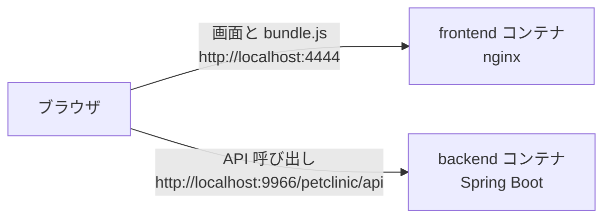
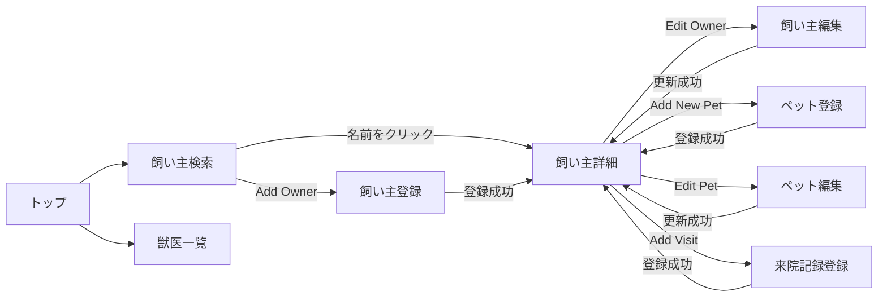
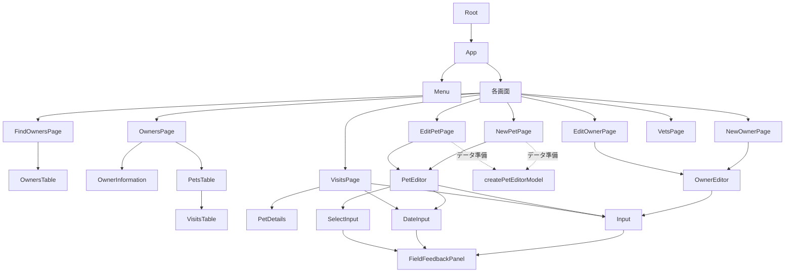

# Spring Petclinic（React 版）フロントエンド設計書

この文書は、`client/` 配下の React アプリケーションの現状の設計をまとめたものです。記載内容は 2026-11-18 時点のコードと、Docker で起動した画面と API の動作確認に基づきます。

## 1. 概要

動物病院の飼い主、ペット、来院記録、獣医を表示・登録する画面です。ブラウザで動く SPA（シングルページアプリケーション）で、データはすべてバックエンドの REST API から取得します（[バックエンド設計書](設計書_バックエンド.md)）。

| 項目 | 内容 |
| --- | --- |
| UI ライブラリ | React 15 |
| 言語 | TypeScript 2.0 |
| ルーティング | react-router 2（`browserHistory`、URL のパスで画面を切り替え） |
| スタイル | Bootstrap 3、Less |
| HTTP 通信 | `fetch`（`whatwg-fetch`） |
| 日付入力 | react-datepicker、moment |
| ビルド | webpack 5 |
| 配信（Docker） | nginx 1.27 |
| 状態管理 | 各コンポーネントのローカル state のみ（Redux などは不使用） |

## 2. 実行時の構成

- 画面の HTML と JavaScript は nginx が配信します。どの URL でも `index.html` を返すため、`/owners/1` のような URL を直接開いても画面が表示されます（`client/nginx.conf` の `try_files`）。
- API は nginx を経由せず、**ブラウザから直接** バックエンドを呼びます。そのため、API の URL はブラウザから届く必要があり、バックエンド側で CORS の許可（`http://localhost:4444`）が必要です。

## 3. ディレクトリ構成

| パス | 内容 |
| --- | --- |
| `src/main.tsx` | 起動処理。`#mount` 要素に画面を描画する |
| `src/Root.tsx` | ルーター（`Router`）の設定 |
| `src/configureRoutes.tsx` | URL と画面コンポーネントの対応表 |
| `src/components/` | 画面と部品のコンポーネント |
| `src/components/owners/` | 飼い主の検索・詳細・登録・編集 |
| `src/components/pets/` | ペットの登録・編集 |
| `src/components/visits/` | 来院記録の登録 |
| `src/components/vets/` | 獣医一覧 |
| `src/components/form/` | 入力部品（テキスト、日付、選択）と入力チェック |
| `src/util/index.tsx` | API の URL 組み立てと送信処理 |
| `src/types/index.ts` | 型定義（画面で扱うデータの形） |
| `src/styles/` | Less、フォント、画像 |
| `public/index.html` | 画面の土台となる HTML |
| `public/images/` | 画像 |
| `webpack.config.docker.js` | Docker 用のビルド設定 |
| `Dockerfile`、`nginx.conf` | Docker 用のビルドと配信の設定 |

## 4. 画面一覧

すべての画面は共通レイアウト `App`（上部メニュー `Menu` と下部ロゴ）の中に表示されます。

| URL | コンポーネント | 内容 | 呼び出す API |
| --- | --- | --- | --- |
| `/` | `WelcomePage` | トップ画面 | なし |
| `/owners/list` | `FindOwnersPage` | 姓で飼い主を検索し、一覧を表示 | `GET api/owners?lastName=` |
| `/owners/new` | `NewOwnerPage` | 飼い主の登録 | `POST /api/owners` |
| `/owners/:ownerId` | `OwnersPage` | 飼い主の詳細と、ペット・来院記録の一覧 | `GET /api/owners/:ownerId` |
| `/owners/:ownerId/edit` | `EditOwnerPage` | 飼い主の編集 | `GET /api/owners/:ownerId`、`PUT /api/owners/:ownerId` |
| `/owners/:ownerId/pets/new` | `NewPetPage` | ペットの登録 | `GET /api/pettypes`、`GET /api/owners/:ownerId`、`POST /api/owners/:ownerId/pets` |
| `/owners/:ownerId/pets/:petId/edit` | `EditPetPage` | ペットの編集 | `GET /api/pettypes`、`GET /api/owners/:ownerId`、`GET /api/owners/:ownerId/pets/:petId`、`PUT` 同 URL |
| `/owners/:ownerId/pets/:petId/visits/new` | `VisitsPage` | 来院記録の登録 | `GET /api/owners/:ownerId`、`POST /api/owners/:ownerId/pets/:petId/visits` |
| `/vets` | `VetsPage` | 獣医と専門分野の一覧 | `GET api/vets` |
| `/error` | `ErrorPage` | エラー表示の確認 | `GET api/oops` |
| 上記以外 | `NotFoundPage` | 該当なし | なし |

「呼び出す API」はコードに書かれているパスをそのまま記載しています。先頭のスラッシュの有無や単数形の `owner` の違いが、そのまま動作に影響します（「8. 既知の問題」を参照）。

### 画面遷移

上部メニューと、検索結果の飼い主名のリンクは通常の `<a href>` です。クリックするとページ全体を読み直します。それ以外の画面内リンクは react-router の `Link` で、ページを読み直さずに画面を切り替えます。

## 5. コンポーネント構成

- **画面（Page）**: `componentDidMount` で API を呼び、結果を自分の state に入れて描画します。
- **編集部品（Editor）**: `OwnerEditor` と `PetEditor` は、新規と編集で共通です。`isNew` が `true` なら POST、`false` なら PUT を送ります。
- **`createPetEditorModel`**: ペットの種類一覧、飼い主、対象ペットの 3 つを並行して取得し、`PetEditor` に渡す形にまとめます。

## 6. API 通信

`src/util/index.tsx` に共通処理があります。

| 関数 | 役割 |
| --- | --- |
| `url(path)` | `${BACKEND_URL}/${path}` を返す。`path` の先頭にスラッシュがあると `//` になる |
| `submitForm(method, path, data, onSuccess)` | JSON を送信し、応答の HTTP ステータスと JSON 本文を `onSuccess` に渡す。204 のときは本文を `{}` とする |

`BACKEND_URL` は、ビルド時に webpack が埋め込む `__API_SERVER_URL__` の値です。

| ビルド方法 | 埋め込まれる URL |
| --- | --- |
| Docker（`webpack.config.docker.js`） | 環境変数 `API_SERVER_URL`。既定は `http://localhost:9966/petclinic` |
| 開発用（`webpack.config.js`） | `http://localhost:9966/petclinic` |
| 本番用（`webpack.config.prod.js`） | `http://localhost:8080` |

URL を変えるには、イメージを作り直す必要があります（`docker-compose.yml` の `frontend.build.args.API_SERVER_URL`）。

## 7. 入力チェックとエラー表示

画面側で、入力のたびに次のチェックを行います（`src/components/form/Constraints.ts`）。

| ルール | 内容 | 使っている項目 |
| --- | --- | --- |
| `NotEmpty` | 1 文字以上 | 飼い主の名・姓・住所・市区町村、来院記録の説明 |
| `Digits(10)` | 1〜10 桁の数字 | 飼い主の電話番号 |

エラーは、項目名をキーにした `IError.fieldErrors` で保持し、`FieldFeedbackPanel` が項目の下に表示します。送信後に API がエラーを返した場合は、応答の **本文** を `IError` として state に入れます。

日付入力（`DateInput`）は、選んだ日付を `YYYY-MM-DD` 形式の文字列にして送ります。ペットの種類は、選んだ `id` と名前を `type` オブジェクトにして送ります。

## 8. 既知の問題

設計時点で見つかった次の不具合は修正済みです。

| 内容 | 対応 |
| --- | --- |
| 飼い主取得の URL が `/api/owner` で、先頭スラッシュにより `//` になる | `/api/owners` に統一し、`url()` でスラッシュを重ねない |
| ペットの種類を `typeId` で送る | `type: { id, name }` で送る |
| 日付が `YYYY/MM/DD` | `YYYY-MM-DD` で送る |
| 成功とみなすステータスが API と違う | 200、201、204 を成功とする |
| 該当なしの検索で一覧が残る | 404 や JSON 以外のときは空の一覧にする |
| 入力エラーが項目に出ない | `errors` ヘッダーを `fieldErrors` に変換する |
| エラー画面が `localhost:8080/api/oups` を呼ぶ | `api/oops` を呼び、返ってきた例外メッセージを表示する |
| 獣医とエラーのメニューが選択状態にならない | `/vets` と `/error` と比較する |

## 9. ビルドと配信

Docker では `client/Dockerfile` で次の順に処理します。

1. `node:18` 上で `npm ci` を実行し、`package-lock.json` どおりに依存関係を入れます。`package.json` の依存関係には互いに合わない組み合わせがあるため、`--legacy-peer-deps` を付けています。
2. Docker 用ビルドに必要な Babel、ローダー、`webpack-cli` を追加で入れます。
3. `webpack.config.docker.js` で `public/dist/bundle.js` を作ります。TypeScript は Babel で変換するため、型チェックは行いません。
4. `nginx:1.27-alpine` に `public/` 一式をコピーして配信します。

元のリポジトリの開発手順（`npm install` と `PORT=4444 npm start`）は、Docker 環境では使っていません。
