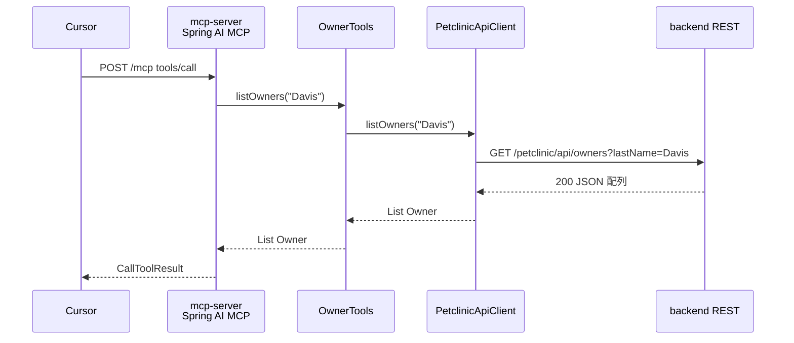

# Cursor と mcp-server のやり取り（可視化ガイド）

手動テスト時に **Cursor（MCP クライアント）** と **`mcp-server`** の間でどのような HTTP / JSON-RPC が行われるか、サーバー側ログとの対応をまとめたドキュメントです。

関連: [README.md](../README.md)（起動・接続手順）、[MCP連携機能設計書](../../docs/MCP導入/MCP連携機能設計書.md)

## 1. プロトコルの前提

| 項目 | 本リポジトリでの値 |
| --- | --- |
| トランスポート | **[Streamable HTTP](https://modelcontextprotocol.io/specification/2025-11-25/basic/transports#streamable-http)**（`spring.ai.mcp.server.protocol=STREAMABLE`） |
| エンドポイント | `http://localhost:8090/mcp`（Compose 内は `http://mcp-server:8090/mcp`） |
| メッセージ形式 | **[JSON-RPC 2.0](https://www.jsonrpc.org/specification)**（MCP 標準の `method` / `params` / `result`。[Messages](https://modelcontextprotocol.io/specification/2025-11-25/basic#messages)） |
| 本文のログ | **出さない**（本リポジトリ固有。`McpHttpTraceFilter` は method・path・status のみ。設計書 9 章） |

Cursor はホスト上で動き、`.cursor/mcp.json` の URL へ接続します。Dev Container 内のエディタから見ても、多くの場合 MCP クライアントはホスト側です。

### 1.1 MCP 標準と本リポジトリ固有

JSON-RPC のメソッド名と結果の枠は [Model Context Protocol 仕様 2025-11-25](https://modelcontextprotocol.io/specification/2025-11-25) の標準です。この文書の手順（`initialize` から `tools/call` まで）はその版の定義に対応します。例の `protocolVersion`（`2024-11-05`）は、クライアントとサーバーが合意した版の値です。ツールの中身（名前・引数）と、既存 API への転送、トレースログは本リポジトリ固有です。

| 区分 | この文書に出てくるもの |
| --- | --- |
| **MCP 標準** | ライフサイクル: [`initialize`](https://modelcontextprotocol.io/specification/2025-11-25/basic/lifecycle#initialization)、[`notifications/initialized`](https://modelcontextprotocol.io/specification/2025-11-25/basic/lifecycle#initialization)。ツール: [`tools/list`](https://modelcontextprotocol.io/specification/2025-11-25/server/tools#listing-tools)、[`tools/call`](https://modelcontextprotocol.io/specification/2025-11-25/server/tools#calling-tools)。結果の枠: [`name` / `description` / `inputSchema`](https://modelcontextprotocol.io/specification/2025-11-25/server/tools#tool)、[`content`（`type` / `text`）](https://modelcontextprotocol.io/specification/2025-11-25/server/tools#text-content)、[`isError`](https://modelcontextprotocol.io/specification/2025-11-25/server/tools#error-handling)。トランスポート: [Streamable HTTP](https://modelcontextprotocol.io/specification/2025-11-25/basic/transports#streamable-http)（`POST`、`Accept: application/json, text/event-stream`） |
| **本リポジトリ固有** | 待ち受け URL（`http://localhost:8090/mcp`。パスは仕様で固定されていない）、`serverInfo` の名前と版、ツール 9 個の定義（`list_owners` や引数 `lastName` など）、既存 REST API への呼び出し、`[mcp-trace]` ログ、エラー文言 |

`initialize` 応答の [`capabilities.tools`](https://modelcontextprotocol.io/specification/2025-11-25/server/tools#capabilities) / [`capabilities.resources`](https://modelcontextprotocol.io/specification/2025-11-25/server/resources) も標準の能力宣言です。Resource の中身（OpenAPI）はこの文書の手順では使いません。

型定義の一覧は [Schema Reference](https://modelcontextprotocol.io/specification/2025-11-25/schema)（`InitializeRequest`、`ListToolsResult`、`CallToolResult` など）です。

## 2. 接続時のやり取り（ツール実行の前）

初回接続時、Cursor はおおよそ次の JSON-RPC を `POST /mcp` で送ります（**実際の JSON は Cursor / MCP SDK のバージョンで細部が異なる場合があります**）。

### 2.1 `initialize`（MCP 標準・クライアント → サーバー）

クライアントがプロトコル版と能力を伝え、サーバー情報を得ます。メソッド名と `params` の枠（`protocolVersion`、`capabilities`、`clientInfo`）は MCP 標準です（[Lifecycle / Initialization](https://modelcontextprotocol.io/specification/2025-11-25/basic/lifecycle#initialization)）。`clientInfo.name` の `"cursor"` はクライアント側の値です。

```json
{
  "jsonrpc": "2.0",
  "id": 1,
  "method": "initialize",
  "params": {
    "protocolVersion": "2024-11-05",
    "capabilities": {},
    "clientInfo": {
      "name": "cursor",
      "version": "…"
    }
  }
}
```

### 2.2 `initialize` のレスポンス（MCP 標準・サーバー → クライアント）

応答の枠（`protocolVersion`、`capabilities`、`serverInfo`）は MCP 標準です（[Lifecycle / Initialization](https://modelcontextprotocol.io/specification/2025-11-25/basic/lifecycle#initialization)、能力の一覧は [Capability Negotiation](https://modelcontextprotocol.io/specification/2025-11-25/basic/lifecycle#capability-negotiation)）。`serverInfo.name` / `version` の値は `application.yml` の `spring.ai.mcp.server.name` など、本リポジトリの設定です。

```json
{
  "jsonrpc": "2.0",
  "id": 1,
  "result": {
    "protocolVersion": "2024-11-05",
    "capabilities": {
      "tools": { "listChanged": false },
      "resources": { "listChanged": false }
    },
    "serverInfo": {
      "name": "petclinic-mcp-server",
      "version": "0.1.0"
    }
  }
}
```

その後、クライアントは `notifications/initialized` を送ることがあります（MCP 標準の通知。応答はありません。[Lifecycle / Initialization](https://modelcontextprotocol.io/specification/2025-11-25/basic/lifecycle#initialization)）。

### 2.3 `tools/list`（MCP 標準・ツール一覧）

メソッド `tools/list` と、応答の `result.tools[]`（`name`、`description`、`inputSchema`）は MCP 標準です（[Listing Tools](https://modelcontextprotocol.io/specification/2025-11-25/server/tools#listing-tools)、ツール定義は [Tool](https://modelcontextprotocol.io/specification/2025-11-25/server/tools#tool)）。並ぶ 9 件の名前とスキーマは本リポジトリ固有で、`tools/OwnerTools.java` などの `@McpTool` から Spring AI が生成します。

リクエスト（MCP 標準）:

```json
{
  "jsonrpc": "2.0",
  "id": 2,
  "method": "tools/list",
  "params": {}
}
```

レスポンス（枠は MCP 標準、`name` などの値は本リポジトリ固有）:

```json
{
  "jsonrpc": "2.0",
  "id": 2,
  "result": {
    "tools": [
      {
        "name": "list_owners",
        "description": "飼い主を検索します。lastName を指定すると…",
        "inputSchema": { "type": "object", "properties": { "lastName": { "type": "string" } } }
      }
    ]
  }
}
```

（`tools` 配列は省略せず 9 件並びます。ここでは 1 件のみ記載。）

### 2.4 この段階のサーバーログ

接続だけのときは `[mcp-trace] inbound` のみ出ることが多く、`tool` / `outbound-api` はまだ出ません。処理本体は **Spring AI MCP**（`spring-ai-starter-mcp-server-webmvc`）の自動構成が担当し、リポジトリ内の自前クラスは [`McpHttpTraceFilter.java`](../src/main/java/org/springframework/samples/petclinic/mcp/config/McpHttpTraceFilter.java) による境界ログが中心です。

## 3. ツール 1 回分の詳細（`list_owners` / `lastName=Davis`）

Agent チャットで飼い主検索を依頼すると、Cursor が **`tools/call`**（MCP 標準。[Calling Tools](https://modelcontextprotocol.io/specification/2025-11-25/server/tools#calling-tools)）を送ります。`params.name` の `list_owners` と `arguments.lastName` は本リポジトリ固有です。

### 3.1 Cursor からのリクエスト（代表例）

HTTP:

```http
POST /mcp HTTP/1.1
Host: localhost:8090
Content-Type: application/json
Accept: application/json, text/event-stream
```

`POST` と `Accept` に `application/json` と `text/event-stream` を並べる形は [Streamable HTTP](https://modelcontextprotocol.io/specification/2025-11-25/basic/transports#streamable-http) の規定です。パス `/mcp` とポートは本リポジトリの設定です。

本文（JSON-RPC）:

```json
{
  "jsonrpc": "2.0",
  "id": 42,
  "method": "tools/call",
  "params": {
    "name": "list_owners",
    "arguments": {
      "lastName": "Davis"
    }
  }
}
```

| フィールド | 区分 | 意味 |
| --- | --- | --- |
| `method` | MCP 標準 | `tools/call`（[Calling Tools](https://modelcontextprotocol.io/specification/2025-11-25/server/tools#calling-tools)） |
| `params.name` | 本リポジトリ固有 | `OwnerTools` の `@McpTool(name = "list_owners")`。名前を `name` で渡す形は仕様どおり |
| `params.arguments` | 本リポジトリ固有 | ツール引数（Java の `listOwners(String lastName)` にバインド）。引数を `arguments` に入れる形は [Calling Tools](https://modelcontextprotocol.io/specification/2025-11-25/server/tools#calling-tools) |

### 3.2 mcp-server 内部の処理順



### 3.3 既存 API の応答（backend → mcp-server）

`PetclinicApiClient#listOwners` が受け取る JSON の例（抜粋）:

```json
[
  {
    "id": 2,
    "firstName": "Betty",
    "lastName": "Davis",
    "address": "638 Cardinal Ave.",
    "city": "Sun Prairie",
    "telephone": "6085551749",
    "pets": []
  },
  {
    "id": 4,
    "firstName": "Harold",
    "lastName": "Davis",
    "address": "563 Friendly St.",
    "city": "Windsor",
    "telephone": "6085553198",
    "pets": []
  }
]
```

処理は既存の [`OwnerRestController`](../../src/main/java/org/springframework/samples/petclinic/rest/controller/OwnerRestController.java)（`mcp-server` 外）が担当します。

### 3.4 mcp-server から Cursor へのレスポンス（代表例）

Spring AI / MCP SDK がツール戻り値を **CallToolResult**（MCP 標準。[Calling Tools](https://modelcontextprotocol.io/specification/2025-11-25/server/tools#calling-tools)、本文の型は [Text Content](https://modelcontextprotocol.io/specification/2025-11-25/server/tools#text-content)）に包みます。`content` と `isError` の枠は標準で、`text` の中身は本リポジトリの戻り値です（Jackson により JSON 文字列化されることが多い）。

```json
{
  "jsonrpc": "2.0",
  "id": 42,
  "result": {
    "content": [
      {
        "type": "text",
        "text": "[{\"id\":2,\"firstName\":\"Betty\",\"lastName\":\"Davis\",...},{\"id\":4,\"firstName\":\"Harold\",\"lastName\":\"Davis\",...}]"
      }
    ],
    "isError": false
  }
}
```

| フィールド | 区分 | 意味 |
| --- | --- | --- |
| `result.content` | MCP 標準 | モデル／UI に渡すペイロード。要素の `type` / `text` も標準（[Text Content](https://modelcontextprotocol.io/specification/2025-11-25/server/tools#text-content)。本サーバーは主に `type: text`） |
| `result.content[].text` | 本リポジトリ固有 | ツールの戻り値（飼い主 JSON の文字列、または `ApiErrorTranslator` の文言） |
| `result.isError` | MCP 標準 | `false` なら成功。`PetclinicApiException` などが起きた場合は `true` になり、メッセージが content に入る（[Error Handling](https://modelcontextprotocol.io/specification/2025-11-25/server/tools#error-handling)） |

Cursor の **Agent チャット**には、この `text` を要約した自然文として表示されます。生 JSON を見るにはサーバーログの `resultPreview` か、下記の API を直接叩く方が確実です。

### 3.5 エラー例（`get_owner` / `ownerId=999`）

リクエスト:

```json
{
  "jsonrpc": "2.0",
  "id": 43,
  "method": "tools/call",
  "params": {
    "name": "get_owner",
    "arguments": { "ownerId": 999 }
  }
}
```

backend が 404 のとき、ツールは `PetclinicApiException` を投げ、クライアント向けには概ね次の形になります。`result` の枠（`content` / `isError: true`）は MCP 標準のツール実行エラー（[Error Handling](https://modelcontextprotocol.io/specification/2025-11-25/server/tools#error-handling)）で、文言は `ApiErrorTranslator`（本リポジトリ固有）です。

```json
{
  "jsonrpc": "2.0",
  "id": 43,
  "result": {
    "content": [
      {
        "type": "text",
        "text": "飼い主 ID 999 は見つかりません。list_owners で ID を確認してください。"
      }
    ],
    "isError": true
  }
}
```

## 4. `[mcp-trace]` ログとソースの対応

既定で `MCP_TRACE_ENABLED=true`（`petclinic.mcp.trace-enabled`）。ホストで:

```bash
docker compose -f docker-compose.dev.yml logs -f mcp-server 2>&1 | grep '\[mcp-trace\]'
```

### 4.1 フェーズとソース

| ログの `phase` / 種別 | 意味 | 主なソース（`mcp-server/`） |
| --- | --- | --- |
| `inbound phase=start/end` | Cursor → `/mcp` の HTTP | [`config/McpHttpTraceFilter.java`](../src/main/java/org/springframework/samples/petclinic/mcp/config/McpHttpTraceFilter.java)（手前で [`OriginValidationFilter.java`](../src/main/java/org/springframework/samples/petclinic/mcp/config/OriginValidationFilter.java)） |
| `tool phase=start/success/error` | ツール名・引数・結果プレビュー | [`McpToolTraceAspect.java`](../src/main/java/org/springframework/samples/petclinic/mcp/config/McpToolTraceAspect.java) + 各 `tools/*.java` |
| `outbound-api phase=start/end` | 既存 API への HTTP | [`PetclinicApiTraceInterceptor.java`](../src/main/java/org/springframework/samples/petclinic/mcp/config/PetclinicApiTraceInterceptor.java) + [`PetclinicApiClient.java`](../src/main/java/org/springframework/samples/petclinic/mcp/client/PetclinicApiClient.java) |

トレースの on/off: [`McpTraceProperties.java`](../src/main/java/org/springframework/samples/petclinic/mcp/config/McpTraceProperties.java)。

### 4.2 `list_owners` 1 回分のログ行

```text
[mcp-trace] inbound phase=start method=POST path=/mcp origin=-
[mcp-trace] tool phase=start name=list_owners args=lastName=Davis
[mcp-trace] outbound-api phase=start method=GET uri=http://backend:9966/petclinic/api/owners?lastName=Davis
[mcp-trace] outbound-api phase=end ... status=200 durationMs=...
[mcp-trace] tool phase=success name=list_owners durationMs=... resultPreview=[{...}]
[mcp-trace] inbound phase=end method=POST path=/mcp status=200 durationMs=...
```

| # | ログ行（抜粋） | 処理 | ソースファイル |
| --- | --- | --- | --- |
| 1 | `inbound phase=start` | `tools/call` の HTTP 受信開始 | `McpHttpTraceFilter.java`（JSON-RPC 解析は Spring AI MCP） |
| 2 | `tool phase=start name=list_owners` | ツール実行開始 | `McpToolTraceAspect.java` → `OwnerTools.java` |
| 3–4 | `outbound-api` … `GET …/owners?lastName=Davis` | 既存 API 呼び出し | `PetclinicApiTraceInterceptor.java` → `PetclinicApiClient#listOwners` |
| 5 | `tool phase=success` … `resultPreview=` | Java 戻り値を MCP 結果へ | `OwnerTools.java` → Spring AI が CallToolResult 化 |
| 6 | `inbound phase=end` … `status=200` | HTTP 応答完了 | `McpHttpTraceFilter.java` |

### 4.3 ログと JSON-RPC の対応表

| 観測できるもの | Cursor リクエスト／レスポンス | `[mcp-trace]` | 備考 |
| --- | --- | --- | --- |
| HTTP 到達 | `POST /mcp` | `inbound start/end` | JSON 本文はログに無し |
| どのツールか | `params.name` | `tool name=` | 一致する |
| 引数 | `params.arguments` | `tool args=` | 一致する |
| Petclinic API | （クライアントは見えない） | `outbound-api uri=` | Cursor からは不可視 |
| ツール結果の中身 | `result.content[].text` | `resultPreview=` | プレビューは最大 500 文字 |
| エラー | `isError: true` | `tool phase=error` | メッセージは `ApiErrorTranslator` 由来 |

## 5. Cursor 側で確認できること

| 場所 | 内容 |
| --- | --- |
| **Settings → MCP** | `petclinic` 接続状態、登録ツール数（9） |
| **Agent チャット** | 選ばれたツール名と、結果の要約文 |
| **Output**（MCP / Cursor MCP） | 接続エラーなど（バージョンで名称が異なる） |

エンドツーエンドで **リクエスト／レスポンス JSON の全文**を見るには、MCP Inspector（`npx @modelcontextprotocol/inspector`）で `tools/call` を直接送る方法もあります。

## 6. backend ログとの同時監視

```bash
docker compose -f docker-compose.dev.yml logs -f mcp-server backend 2>&1 | grep -E '\[mcp-trace\]|GET /petclinic/api'
```

`outbound-api` の URI と、backend のアクセスログのパスが同じタイミングで並べば、Cursor → MCP → 既存 API まで一連の流れを追えます。